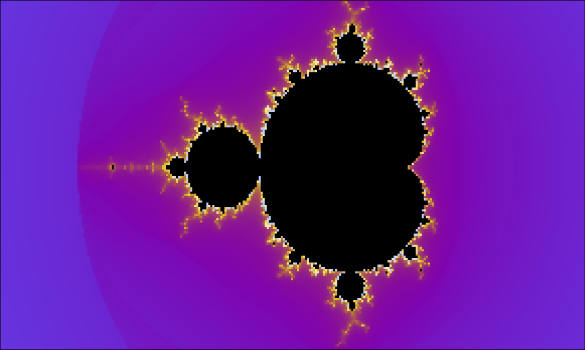

# FractalForge

**An interactive Mandelbrot set renderer for the terminal, written in Go.**

FractalForge renders fractals using Unicode half-block characters, 24-bit RGB colors, and smooth escape-time coloring. Built as a lightweight CLI tool for exploring fractal mathematics and customizing the terminal.



## Features

- Interactive zooming and panning
- Smooth escape-time coloring
- 8 built-in color palettes
- Continuous and cyclic coloring modes
- 6 Mandelbrot location presets
- Automatic terminal sizing
- Configurable coordinates, iterations, and rendering dimensions
- True-color rendering using Unicode half-block characters

## Installation

Requires Go and a terminal supporting 24-bit RGB colors.

```bash
git clone https://github.com/Guntera-ui/fractalforge.git
cd fractalforge
go build -o fractalforge .
./fractalforge
```

To install it as a command available anywhere:

```bash
mkdir -p ~/.local/bin
go build -o ~/.local/bin/fractalforge .
```

Ensure `~/.local/bin` is included in your `PATH`.

For Nix users, the repository also provides a development environment:

```bash
nix develop
go run .
```

## Usage

Render the Mandelbrot set:

```bash
fractalforge
```

Explore interactively:

```bash
fractalforge -interactive
```

Explore Seahorse Valley with the Classic palette:

```bash
fractalforge -preset seahorse -palette classic -interactive
```

Try cyclic coloring:

```bash
fractalforge -palette catppuccin -coloring cyclic -color-period 32
```

### Interactive Controls

| Key | Action |
|---|---|
| `W` / `S` | Pan up / down |
| `A` / `D` | Pan left / right |
| `+` / `-` | Zoom in / out |
| `Q` or `Ctrl+C` | Quit |

### CLI Options

| Flag | Description |
|---|---|
| `-interactive` | Enable interactive mode |
| `-preset` | Select a location preset |
| `-palette` | Select a color palette |
| `-coloring` | `continuous` or `cyclic` |
| `-color-period` | Iterations per color cycle (default: 32) |
| `-zoom` | Zoom multiplier |
| `-x`, `-y` | Viewport center coordinates |
| `-iter` | Maximum iterations (default: 10000) |
| `-width`, `-height` | Override automatic canvas sizing |
| `-aspect` | Terminal character aspect ratio |
| `-list-presets` | Show available presets |
| `-list-palettes` | Show available palettes |
| `-help` | Display all CLI options |

### Palettes

`classic` · `catppuccin` · `tokyonight` · `gruvbox` · `dracula` · `nord` · `rosepine` · `kanagawa`

### Presets

`full` · `seahorse` · `elephant` · `triple-spiral` · `minibrot` · `scepter`

### Coloring Modes

**Continuous:** Uses aggressive logarithmic color mapping, reaching the final palette color at approximately 128 smooth iterations.

**Cyclic:** Repeats the palette at a configurable interval, smoothly transitioning between its last and first colors.

Both modes retain smooth escape-time calculations.

## How It Works

FractalForge evaluates the Mandelbrot recurrence:

$$
z_{n+1}=z_n^2+c,\qquad z_0=0
$$

A point escapes when:

$$
|z_n|>2
$$

The escape-time value is smoothed using:

$$
\nu=n+1-\log_2(\log_2|z_n|)
$$

This fractional value is mapped onto a color gradient using RGB interpolation.

Each `▀` character represents two vertically stacked fractal samples, using the terminal's foreground and background colors.
